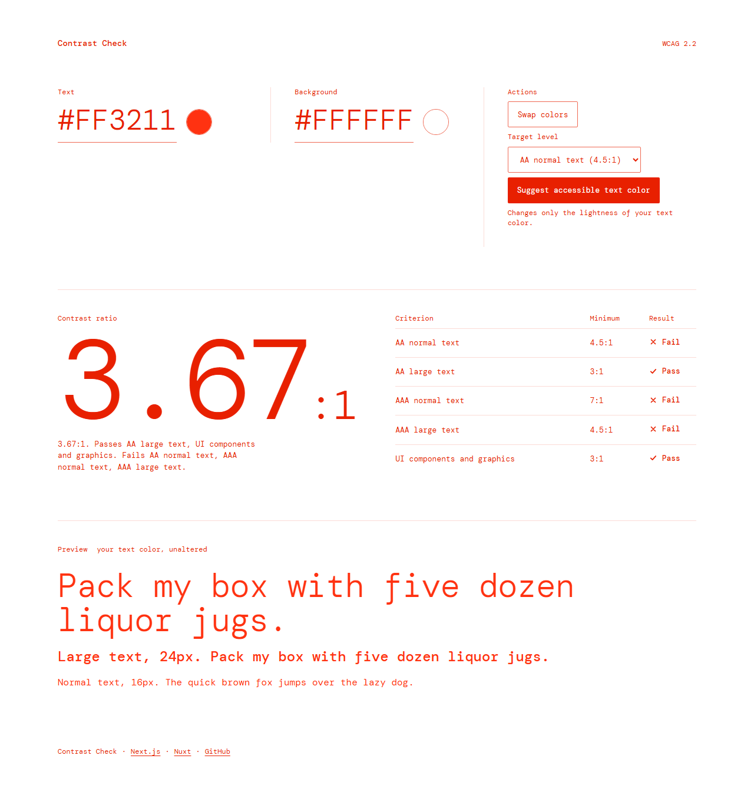

# Contrast Check

A WCAG 2.2 color contrast checker, built twice: once in Next.js (React) and once in Nuxt (Vue), from the same core logic and tested by the same end-to-end suite.

**Live:** [Next.js version](https://contrast-check-next.vercel.app) · [Nuxt version](https://contrast-check-nuxt.vercel.app)



On a phone the layout stacks into a single column, with the ratio still as the largest element:


## The page is the preview

The page takes the background color you choose, and the specimen in the Preview section uses your text color exactly, with no adjustment. It is the thing being tested, so it is allowed to fail.

Everything else, the labels, borders, focus ring and buttons, uses a theme derived from your text color by `deriveTheme` in `packages/core`, which reuses the same `suggestTextColor` that powers the suggestion. If the pair reaches AA (4.5:1), the interface uses your exact colors. If it does not, only the interface gets the closest tone of your text color that does (same hue and saturation, HSL lightness only), and if no tone can, near-black or near-white. So the app uses its own algorithm to stay readable with any pair. The theme is computed on the server from the URL, so the first paint is already themed, and while a hex field holds an invalid value the theme keeps the last valid pair.

| Dark surface, `#5B7BB5` on `#12151C` | Failing pair, `#EEEEEE` on white |
| --- | --- |
|  |  |
| The page and the interface follow the chosen colors, not the operating system theme. This pair falls just short of AA, so the interface uses a slightly lighter blue. | The specimen almost disappears, and the interface stays legible. |

| Role | Rule | Contrast floor |
| --- | --- | --- |
| `surface` | The chosen background | Not applicable |
| `ink` | The chosen text color when the pair reaches 4.5:1, else its closest passing tone | 4.5:1 on the surface |
| `ink-muted` | Ink mixed toward the surface as far as possible. Labels and secondary text | 4.5:1 on the surface |
| `line` | Ink mixed further toward the surface. Input underlines and control borders | 3.1:1 on the surface (WCAG 1.4.11 asks for 3:1) |
| `hairline` | Ink mixed 84% toward the surface. Decorative dividers only | None; never a control boundary |
| `tint` | Ink mixed 90% toward the surface. Brief highlight of the Text input after a suggestion | None in the design; `deriveTheme` still keeps ink on tint at 4.5:1 |

## Why two frameworks

The application is small on purpose, so the interesting question is what stays the same when the framework changes. Here the answer is almost everything that matters: the color math, the design tokens, the rendered HTML and the accessibility behavior.

Color parsing, relative luminance, contrast ratio, criteria evaluation, the text color suggestion, the derived theme, the screen reader summary and the URL state helpers live in `packages/core` as pure TypeScript with no framework or DOM dependency. The design tokens (the theme roles as custom properties, the type scale, spacing, the Tailwind theme mapping, focus and reduced-motion styles) live there too, as a single CSS file that both apps import.

Each app is a thin layer of components over that core. A single Playwright suite in `e2e/` runs against both production builds as separate projects (`next` on port 3100, `nuxt` on port 3200), so any divergence in behavior or accessibility shows up as a failing test rather than a code review comment.

## Features

- Text and background color inputs that accept `#RGB` and `#RRGGBB` (the `#` is optional), each synced with a circular native color picker
- Inline validation with an accessible error message
- Swap button that exchanges the two colors
- Specimen in three sizes (a fluid 36 to 56px line, 24px and 16px), directly on the page
- Contrast ratio with two decimals, for example `4.54:1`, as the largest element on the page
- Pass/fail results for AA normal text (4.5), AA large text (3), AAA normal text (7), AAA large text (4.5) and UI components and graphics (3)
- Suggestion of an accessible text color for AA or AAA, or a message when no color can reach the target
- A page and interface themed from the chosen pair, as described above
- Shareable state in the URL (`?fg=777777&bg=ffffff`), read on the server so the first render already shows it
- Mobile-first layout with a single breakpoint at 768px

## Accessibility

- A one-sentence summary in an `aria-live="polite"` region, instead of announcing the whole results table on every keystroke: screen reader users hear one sentence per change.
- Pass and fail are shown with an icon and the words "Pass" and "Fail", never color alone, so the status survives color blindness and forced colors.
- Validation errors are tied to their field with `aria-describedby` and `aria-invalid`, so the error is read when the field is focused.
- Every control has a visible focus ring (2px in the ink color, 3px offset), and control borders keep at least 3:1 contrast against the page.
- The interface passes WCAG AA contrast for any pair of colors, because its text and borders come from the derived theme: a contrast checker that fails its own criteria is not credible. axe-core finds no violations even with a failing pair, where only the specimen is excluded from the scan, since it is the thing being tested.
- Pairs that pass AA are shown with their exact colors, which an end-to-end test checks.
- `prefers-reduced-motion` disables transitions and transforms. The theme comes from the colors you choose, not from `prefers-color-scheme`.
- Everything is operable with the keyboard alone, in a logical tab order that matches the visual order, and the full flow is covered by an end-to-end test that uses only key presses.
- axe-core finds no violations in either app, including the invalid-input state.

## How the suggestion works

The suggestion keeps the hue and saturation of the text color and changes only its HSL lightness, until the contrast against the background reaches the chosen target (4.5:1 for AA, 7:1 for AAA).

Contrast is not monotonic in lightness. As the text gets lighter or darker it first moves toward the background's luminance, so the ratio falls, and only after crossing it does the ratio rise again. A single binary search over lightness would therefore be unreliable. Instead, two searches run separately: one for colors lighter than the background and one for colors darker than it. In each direction the condition "passes the target" is monotonic, so a binary search finds the boundary lightness exactly. The result is quantized to 8-bit RGB before the condition is checked, so the returned color is guaranteed to pass.

Of the two candidates, the one closest to the original lightness is returned. If the original color already passes, it is returned unchanged. If neither direction can reach the target, for example #888888 on #777777 at AAA, the function returns `null` and the app says so instead of inventing a color.

## Project structure

```
PRODUCT.md              Design governance: users, task, principles, anti-references
DESIGN.md               Design governance: theme, typography, layout, motion, floors
packages/core/          Pure logic and shared design tokens
  src/color.ts            parseHex, relativeLuminance, contrastRatio, evaluate,
                          suggestTextColor, summarize
  src/theme.ts            deriveTheme, themeToCssVars, mix, fadeToward
  src/url-state.ts        Query string parsing and building
  src/styles/tokens.css   Design tokens, Tailwind theme, focus and motion styles
apps/next/              Next.js app (App Router, React)
apps/nuxt/              Nuxt app (Vue, Composition API)
e2e/                    Playwright and axe-core suite, run against both apps
scripts/                Screenshot generation for this README
```

## Tech stack

- Bun 1.x workspaces
- Next.js 16.4 with React 19.3 (`apps/next`)
- Nuxt 4.6 with Vue 3.5 (`apps/nuxt`)
- Tailwind CSS 4.3 with design tokens as CSS custom properties
- DM Mono, self-hosted through Fontsource (`@fontsource/dm-mono` 5.3), with no request to a font CDN
- TypeScript 7.0 in `packages/core` and `apps/next`; `apps/nuxt` uses TypeScript 6.0 because vue-tsc does not yet support TypeScript 7
- Biome 2.6 for linting and formatting, including Vue files
- Vitest 5.1 for unit tests
- Playwright 1.65 and @axe-core/playwright 4.14 for end-to-end and accessibility tests

No component library is used; every component is written by hand.

## Testing

- **Unit tests** (Vitest, `packages/core`): contrast ratio against the WCAG reference values (`#000000` on `#FFFFFF` is 21.00, `#767676` is 4.54 and passes AA, `#777777` is 4.48 and fails), hex parsing, criteria evaluation, the summary text, the suggestion algorithm (including hue preservation and unreachable targets) and the derived theme across a matrix of eight color pairs.
- **End-to-end tests** (Playwright, `e2e/`): typing updates the ratio and criteria, swap, the color picker sync, suggestion, URL state in both directions, the live summary, exact colors for an approved pair, and a full keyboard-only flow. The same files run against Next and Nuxt.
- **Accessibility tests** (axe-core): scans with no violations for both apps under light and dark operating system color schemes, with an invalid input, and with a failing pair where only the specimen is excluded.

## Running locally

Requires [Bun](https://bun.sh).

```bash
bun install
bunx playwright install chromium   # once, for the end-to-end tests
```

```bash
bun run dev:next      # Next.js on http://localhost:3000
bun run dev:nuxt      # Nuxt on http://localhost:3001
bun run lint          # Biome
bun run typecheck     # tsc in core and next, nuxt typecheck in nuxt
bun run test          # Vitest
bun run test:e2e      # Playwright against both production builds
bun run build         # Production build of both apps
bun run screenshots   # Regenerate the images in docs/
```

## License

MIT. See [LICENSE](LICENSE).
