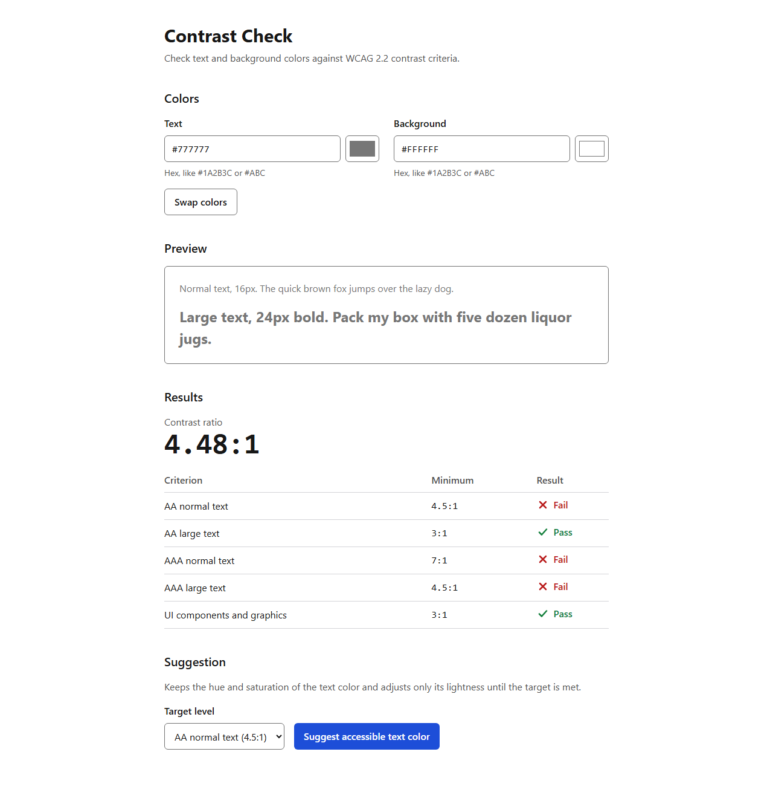

# Contrast Check

A WCAG 2.2 color contrast checker, built twice: once in Next.js (React) and once in Nuxt (Vue), from the same core logic and tested by the same end-to-end suite.



## Why two frameworks

The application is small on purpose, so the interesting question is what stays the same when the framework changes. Here the answer is almost everything that matters: the color math, the design tokens, the rendered HTML and the accessibility behavior.

Color parsing, relative luminance, contrast ratio, criteria evaluation, the text color suggestion, the screen reader summary and the URL state helpers live in `packages/core` as pure TypeScript with no framework or DOM dependency. The design tokens (light and dark custom properties, the Tailwind theme mapping, focus and reduced-motion styles) live there too, as a single CSS file that both apps import.

Each app is a thin layer of components over that core. A single Playwright suite in `e2e/` runs against both production builds as separate projects (`next` on port 3100, `nuxt` on port 3200), so any divergence in behavior or accessibility shows up as a failing test rather than a code review comment.

## Features

- Text and background color inputs that accept `#RGB` and `#RRGGBB`, each synced with a native color picker
- Inline validation with an accessible error message
- Swap button that exchanges the two colors
- Live preview with normal (16px) and large (24px bold) text
- Contrast ratio with two decimals, for example `4.54:1`
- Pass/fail results for AA normal text (4.5), AA large text (3), AAA normal text (7), AAA large text (4.5) and UI components and graphics (3)
- Suggestion of an accessible text color for AA or AAA, or a message when no color can reach the target
- Shareable state in the URL (`?fg=777777&bg=ffffff`), read on the server so the first render already shows it

## Accessibility

- A short summary in a visually hidden `aria-live="polite"` region, instead of announcing the whole results table on every keystroke: screen reader users hear one sentence per change.
- Pass and fail are shown with an icon and the words "Pass" and "Fail", never color alone, so the status survives color blindness and forced colors.
- Validation errors are tied to their field with `aria-describedby` and `aria-invalid`, so the error is read when the field is focused.
- Every control has a visible focus ring with at least 3:1 contrast against the page in both themes.
- The interface itself passes WCAG AA contrast in the light and dark themes, because a contrast checker that fails its own criteria is not credible.
- `prefers-color-scheme` selects the theme and `prefers-reduced-motion` disables transitions and animations.
- Everything is operable with the keyboard alone, in a logical tab order, and the full flow is covered by an end-to-end test that uses only key presses.
- axe-core finds no violations in either app, in either theme, including the invalid-input state.

## How the suggestion works

The suggestion keeps the hue and saturation of the text color and changes only its HSL lightness, until the contrast against the background reaches the chosen target (4.5:1 for AA, 7:1 for AAA).

Contrast is not monotonic in lightness. As the text gets lighter or darker it first moves toward the background's luminance, so the ratio falls, and only after crossing it does the ratio rise again. A single binary search over lightness would therefore be unreliable. Instead, two searches run separately: one for colors lighter than the background and one for colors darker than it. In each direction the condition "passes the target" is monotonic, so a binary search finds the boundary lightness exactly. The result is quantized to 8-bit RGB before the condition is checked, so the returned color is guaranteed to pass.

Of the two candidates, the one closest to the original lightness is returned. If the original color already passes, it is returned unchanged. If neither direction can reach the target, for example #888888 on #777777 at AAA, the function returns `null` and the app says so instead of inventing a color.

## Project structure

```
packages/core/          Pure logic and shared design tokens
  src/color.ts            parseHex, relativeLuminance, contrastRatio, evaluate,
                          suggestTextColor, summarize
  src/url-state.ts        Query string parsing and building
  src/styles/tokens.css   Design tokens, Tailwind theme, focus and motion styles
apps/next/              Next.js app (App Router, React)
apps/nuxt/              Nuxt app (Vue, Composition API)
e2e/                    Playwright and axe-core suite, run against both apps
scripts/                Screenshot generation for this README
```

## Tech stack

- Bun 1.x workspaces
- Next.js 16.4 with React 19.3 (`apps/next`)
- Nuxt 4.6 with Vue 3.5 (`apps/nuxt`)
- Tailwind CSS 4.3 with design tokens as CSS custom properties
- TypeScript 7.0 in `packages/core` and `apps/next`; `apps/nuxt` uses TypeScript 6.0 because vue-tsc does not yet support TypeScript 7
- Biome 2.6 for linting and formatting, including Vue files
- Vitest 5.1 for unit tests
- Playwright 1.65 and @axe-core/playwright 4.14 for end-to-end and accessibility tests

No component library is used; every component is written by hand.

## Testing

- **Unit tests** (Vitest, `packages/core`): contrast ratio against the WCAG reference values (`#000000` on `#FFFFFF` is 21.00, `#767676` is 4.54 and passes AA, `#777777` is 4.48 and fails), hex parsing, criteria evaluation, the summary text and the suggestion algorithm, including hue preservation and unreachable targets.
- **End-to-end tests** (Playwright, `e2e/`): typing updates the ratio and criteria, swap, the color picker sync, suggestion, URL state in both directions, the live summary, and a full keyboard-only flow. The same files run against Next and Nuxt.
- **Accessibility tests** (axe-core): a scan with no violations in the light and dark themes, for both apps, including an invalid-input state.

## Running locally

Requires [Bun](https://bun.sh).

```bash
bun install
bunx playwright install chromium   # once, for the end-to-end tests
```

```bash
bun run dev:next      # Next.js on http://localhost:3000
bun run dev:nuxt      # Nuxt on http://localhost:3000
bun run lint          # Biome
bun run typecheck     # tsc in core and next, nuxt typecheck in nuxt
bun run test          # Vitest
bun run test:e2e      # Playwright against both production builds
bun run build         # Production build of both apps
bun run screenshots   # Regenerate the images in docs/
```

## License

MIT. See [LICENSE](LICENSE).
