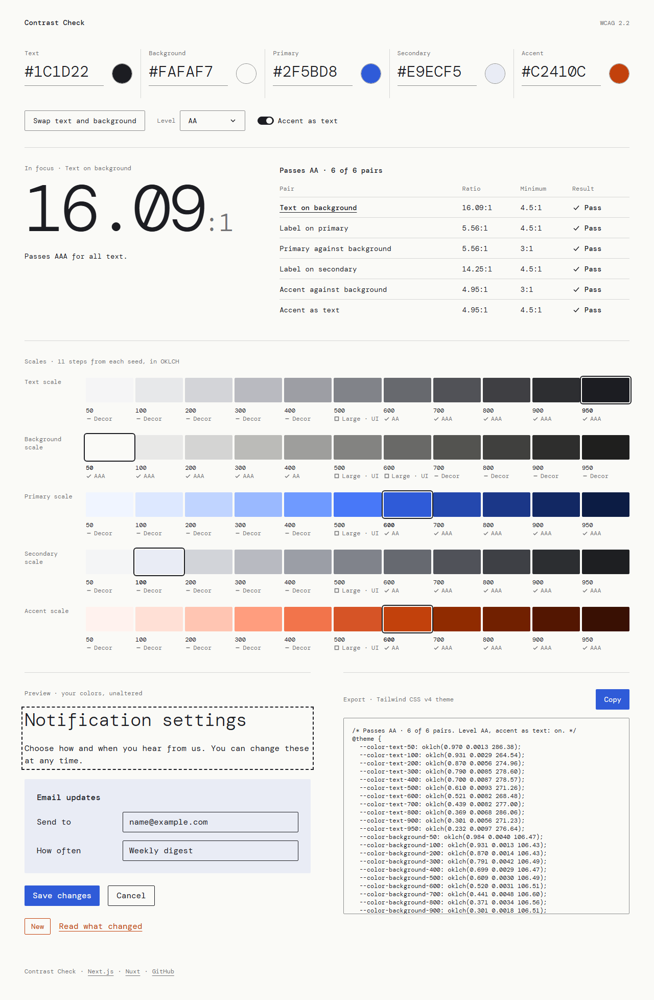
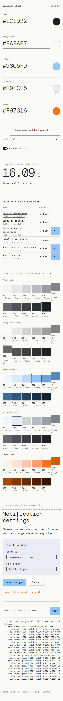
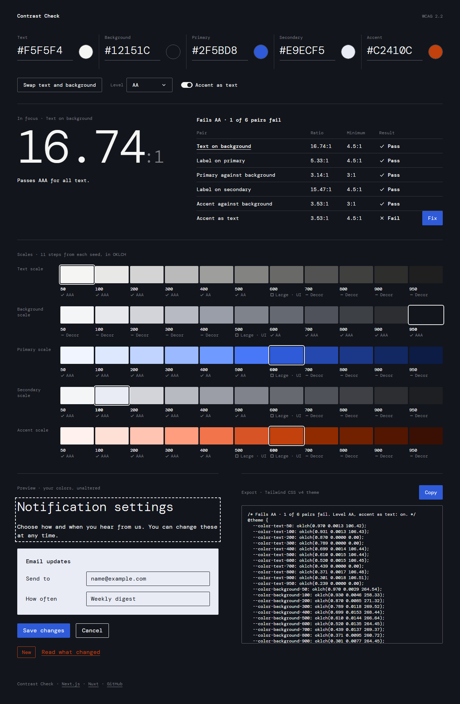
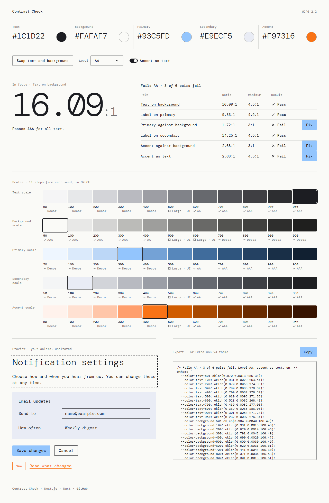

# Contrast Check

A WCAG 2.2 palette contrast checker, built twice: once in Next.js (React) and once in Nuxt (Vue), from the same core logic and tested by the same end-to-end suite.

**Live:** [Next.js version](https://contrast-check-next.vercel.app) · [Nuxt version](https://contrast-check-nuxt.vercel.app)

You choose five colors (text, background, primary, secondary and accent). The app checks the six pairs they form in an interface at AA or AAA, repairs a failing pair with one button, shows an 11-step scale for each color, previews the palette on a sample screen and exports it as a Tailwind CSS v4 theme.



On a phone the layout stacks into a single column, with the pair in focus and its ratio still the largest element:



## The page is the palette

The page takes the background color you choose, and the Preview section uses all five colors exactly, with no adjustment. It is the thing being tested, so it is allowed to fail.

Everything else, the labels, borders, focus ring and buttons, uses a theme derived from your text and background by `deriveTheme` in `packages/core`, which reuses the same `suggestTextColor` that powers the fix. If the pair reaches AA (4.5:1), the interface uses your exact colors. If it does not, only the interface gets the closest tone of your text color that does (same hue and chroma, OKLCH lightness only), and if no tone can, near-black or near-white. The theme is computed on the server from the URL, so the first paint is already themed, and while a hex field holds an invalid value the theme keeps the last valid palette.

Filled buttons (Fix and Copy) use your primary with the label color that suits it when that pair passes AA, and ink on surface otherwise.

| Dark surface, `#F5F5F4` on `#12151C`                                                                                                                   | A light primary and an orange accent                                                                                                          |
| ------------------------------------------------------------------------------------------------------------------------------------------------------ | --------------------------------------------------------------------------------------------------------------------------------------------- |
|  |  |
| The page and the interface follow the chosen colors, not the operating system theme.                                                                   | Primary `#93C5FD` and accent `#F97316` fall short on the page background. The chrome stays legible.                                           |

| Role        | Rule                                                                             | Contrast floor                                  |
| ----------- | -------------------------------------------------------------------------------- | ----------------------------------------------- |
| `surface`   | The chosen background                                                            | Not applicable                                  |
| `ink`       | The chosen text color when the pair reaches 4.5:1, else its closest passing tone | 4.5:1 on the surface                            |
| `ink-muted` | Ink mixed toward the surface as far as possible. Labels and secondary text       | 4.5:1 on the surface                            |
| `line`      | Ink mixed further toward the surface. Input underlines and control borders       | 3.1:1 on the surface (WCAG 1.4.11 asks for 3:1) |
| `hairline`  | Ink mixed 84% toward the surface. Decorative dividers only                       | None; never a control boundary                  |

The interface uses only the default Tailwind scales on an 8px grid, with no arbitrary values. The one named utility, `grid-cols-scale`, exists because no standard class expresses a fixed column next to a flexible one.

## Why two frameworks

The application is small on purpose, so the interesting question is what stays the same when the framework changes. Here the answer is almost everything that matters: the color math, the screen state, every string the screen shows, the design tokens, the rendered HTML and the accessibility behavior.

Color parsing, relative luminance, contrast ratio, the six palette pairs, the fix, the scales, the Tailwind export, the derived theme and the URL state live in `packages/core` as pure TypeScript with no framework or DOM dependency. So does the whole screen: `view.ts` holds a state type, a pure `reduce(state, action)` and a pure `paletteView(state)` that returns everything the screen shows, already formatted (pair rows, ratios, messages, step labels, preview colors, the export text). The design tokens (the theme roles as custom properties, the font, the easing, the `tall` variant, the Tailwind theme mapping, focus and reduced-motion styles) live there too, as a single CSS file that both apps import.

Each app is a thin layer over that core. It holds the state (`useReducer` in React, a `shallowRef` in Vue), dispatches actions, renders the view, and does the browser-only work: URL sync, the clipboard, moving focus between scale steps and mirroring the theme on `<html>`. A single Playwright suite in `e2e/` runs against both production builds as separate projects (`next` on port 3100, `nuxt` on port 3200), so any divergence in behavior or accessibility shows up as a failing test rather than a code review comment.

## Features

- Five color inputs that accept `#RGB` and `#RRGGBB` (the `#` is optional), each synced with a circular native color picker, with an error line whose space is always reserved
- Six pairs checked at AA or AAA: text on background, label on primary, primary against background, label on secondary, accent against background and accent as text (the last one can be switched off). The label on primary and on secondary is whichever of text and background contrasts more with that fill
- A pair in focus with its ratio in very large type, a one-sentence verdict and a message for the result of an action
- A pairs table with ratio, minimum and Pass or Fail, and a Fix button on failing rows only. Fix changes only the active color of the role, never its seed, and only if every pair that passed before still passes. Otherwise nothing changes and the message says which pair it would break
- Swap for text and background, and a Level control (AAA raises only the text pairs to 7:1)
- A scale of 11 steps for each role, built in OKLCH from the seed, each step annotated with its ratio and the highest use it allows (AAA, AA, large text and UI, decorative). Choosing a step sets the role's active color
- A preview of a settings screen in the exact colors, where the part that uses the pair in focus gets a dashed outline
- The palette as a Tailwind CSS v4 `@theme` block: 55 scale variables, five semantic aliases with a comment on the pair that applies to each, and `--color-primary-label` and `--color-secondary-label`, with a Copy button
- Shareable state in the URL (`?text=1c1d22&background=fafaf7&primary=2f5bd8&secondary=e9ecf5&accent=c2410c&level=AA&accentText=1`), read on the server so the first render already shows it. A role is `seed` or `seed.active`. The old `?fg=&bg=` links still load
- Mobile-first layout with `md` (768px) and `lg` (1024px) breakpoints, plus a `tall` variant for screens at least 800px high that gives the ratio its largest size

## Accessibility

- Changes of state are announced through one hidden `aria-live="polite"` region with a short sentence ("Text on background, 16.09 to 1. Passes AA · 6 of 6 pairs."). The results of Fix and Copy are announced through the visible message.
- The select has its own chevron. In forced-colors (high contrast) mode it goes back to the native control, so the arrow does not disappear.
- Pass and fail are shown with an icon and the words "Pass" and "Fail", never color alone.
- Each scale is a radio group with a roving tabindex, arrow keys, Home and End, and selection that follows focus. A step's accessible name says its step, hex, ratio and use ("600, #2F5BD8, 5.56:1, AA text").
- Validation errors are tied to their field with `aria-describedby` and `aria-invalid`.
- Every control has a visible focus ring (2px in the ink color, 2px offset), and control borders keep at least 3:1 contrast against the page.
- The interface passes WCAG AA contrast for any palette, because its text and borders come from the derived theme. axe-core finds no violations even with a failing palette, where only the preview is excluded from the scan, since it is the thing being tested.
- `prefers-reduced-motion` disables transitions and transforms. The theme comes from the colors you choose, not from `prefers-color-scheme`.
- Everything is operable with the keyboard alone, in a tab order that matches the visual order.

## How the fix works

The fix keeps the hue and chroma of the role's color in OKLCH and changes only its perceptual lightness, until the pair reaches its threshold. OKLCH is used because equal steps in its lightness look like equal steps to the eye, so the result is the nearest passing tone rather than a jump along a skewed axis.

Contrast is not monotonic in lightness. As a color gets lighter or darker it first moves toward the other color's luminance, so the ratio falls, and only after crossing it does the ratio rise again. A binary search over lightness would therefore be unreliable. The search samples instead: 1001 lightness values from 0 to 1, each converted back to sRGB (an out-of-gamut color keeps its lightness and hue and loses chroma) and quantized to 8 bits before the check, so the returned color is guaranteed to pass. Sampling also lets the fix add its own constraint: a candidate is accepted only if every pair that passed before still passes.

Of the acceptable candidates, the one closest to the original lightness is returned, and a tie goes to the darker one. If none is acceptable, the fix returns the pairs the best unconstrained candidate would have broken, and the app says so instead of inventing a color. The derived theme of the interface uses the same search.

## Project structure

```
PRODUCT.md              Design governance: users, task, principles, anti-references
DESIGN.md               Design governance: theme, typography, layout, motion, floors
packages/core/          Pure logic and shared design tokens
  src/color.ts            parseHex, relativeLuminance, contrastRatio, verdictForRatio
  src/palette.ts          The six pairs, checkPalette, labelColorFor, fixPair
  src/scale.ts            scaleFor, annotateScale
  src/export.ts           toTailwindTheme
  src/view.ts             ViewState, reduce, paletteView: everything the screen shows
  src/theme.ts            deriveTheme, themeToCssVars, mix, fadeToward
  src/lightness.ts        The lightness search, suggestTextColor
  src/url-state.ts        Defaults and query parsing and building
  src/styles/tokens.css   Theme colors, font, easing, tall variant, focus and motion styles
apps/next/              Next.js app (App Router, React)
apps/nuxt/              Nuxt app (Vue, Composition API)
e2e/                    Playwright and axe-core suite, run against both apps
scripts/                Screenshot generation for this README
```

## Tech stack

- Bun 1.x workspaces
- Next.js 16.4 with React 19.3 (`apps/next`)
- Nuxt 4.6 with Vue 3.5 (`apps/nuxt`)
- Tailwind CSS 4.3, default scales only, with the derived theme as CSS custom properties
- DM Mono, self-hosted through Fontsource (`@fontsource/dm-mono` 5.3), with no request to a font CDN
- TypeScript 7.0 in `packages/core` and `apps/next`; `apps/nuxt` uses TypeScript 6.0 because vue-tsc does not yet support TypeScript 7
- Biome 2.6 for linting and formatting, including Vue files
- Vitest 5.1 for unit tests
- Playwright 1.65 and @axe-core/playwright 4.14 for end-to-end and accessibility tests

No component library is used; every component is written by hand.

## Testing

- **Unit tests** (Vitest, `packages/core`): contrast ratio against the WCAG reference values, hex parsing, the verdict bands, the six pairs at AA and AAA, the fix (including the blocked cases and the guarantee that no passing pair breaks), the scales, the Tailwind export (a snapshot for a fixed palette), the URL state, the derived theme across a matrix of eight color pairs and the view layer: every action of the reducer and every field of `paletteView`.
- **End-to-end tests** (Playwright, `e2e/`): typing and picking colors, swap, level, the accent switch, URL state in both directions (including legacy and malformed links), a partial hex that keeps the last valid palette, Fix and the blocked layout, the scale radio groups, the export and Copy, the live summary and a keyboard-only tab order. The same files run against Next and Nuxt.
- **Accessibility tests** (axe-core): scans with no violations for both apps on the default palette, with an invalid hex, with a failing palette and on a dark palette, with only the preview excluded.

## Running locally

Requires [Bun](https://bun.sh).

```bash
bun install
bunx playwright install chromium   # once, for the end-to-end tests
```

```bash
bun run dev:next      # Next.js on http://localhost:3000
bun run dev:nuxt      # Nuxt on http://localhost:3001
bun run lint          # Biome
bun run typecheck     # tsc in core and next, nuxt typecheck in nuxt
bun run test          # Vitest
bun run test:e2e      # Playwright against both production builds
bun run build         # Production build of both apps
bun run screenshots   # Regenerate the images in docs/
```

## License

MIT. See [LICENSE](LICENSE).
